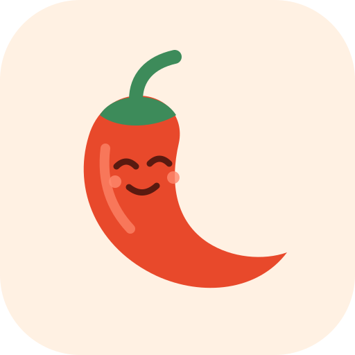
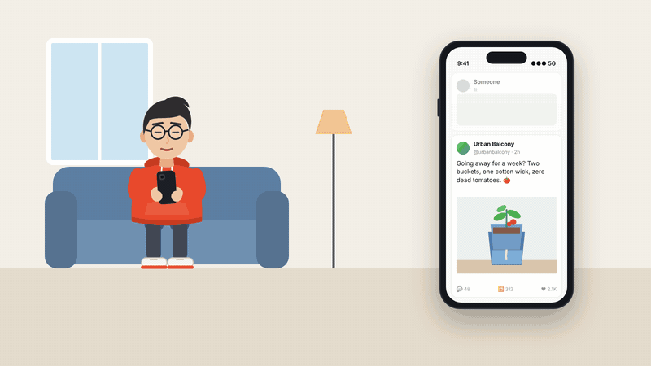

<p align="center"></p>

# Chilli

**Press the Action Button. Your AI remembers it.**

Self-hosted memory for Claude, ChatGPT and Cursor: screenshots and links go to your own server, a model
describes them, and your assistant finds them over MCP.



<sub>An illustration of the flow, not a screen recording; the chat answers are what Chilli returns for its demo data. [Full video (MP4)](docs/assets/demo.mp4).</sub>

## Why Chilli

- **One-button capture.** The iPhone Action Button saves a screenshot; the share sheet saves a link;
  a browser extension saves pages, selections and tab screenshots. No folders, tags or titles.
- **A remote MCP server.** Add it as a custom connector in claude.ai and your saves are there in every
  chat and in scheduled tasks, not only on one computer.
- **Ratings per project.** Describe your projects once; every save gets a 1-10 usefulness score for each.
- **Recall.** Forgotten but useful saves come back (`from_archive`), reminders when you ask for them,
  and a daily or weekly digest written by a scheduled task.
- **Your X bookmarks, automatically (optional).** Connect your X account once and every post you bookmark
  on X becomes a save, through the official X API and your own developer app (typically under $1 a month).
- **Bring your own model.** Anthropic, or any OpenAI-compatible API, including a local model in Ollama.
- **Small to run.** One `docker compose` with Postgres on a small VPS or a home server.

## Quick start

1. `git clone https://github.com/pawelmnowak1990-Now4czek/chilli.git && cd chilli`
2. `./setup.sh` asks for your domain, model and key, writes `.env`, starts the containers and prints
   your capture token and MCP address.
3. Add the [iPhone Shortcut](docs/guides/ios-shortcuts.md) and the [connector in your AI client](docs/guides/mcp-clients.md).

Details, nginx instead of Caddy, updates and backups: [docs/guides/install.md](docs/guides/install.md).
Try it with demo data first: `docker compose exec api python -m app.demo_seed --apply`
([more](docs/guides/install.md#try-it-with-demo-data)).

## Privacy

- Your saves, screenshots and ratings live only on your server, in your database.
- Screenshots and page text are sent to the model provider you configure, to be described; with a
  local model (Ollama, LM Studio) they never leave your machines.
- Embeddings are computed locally; search needs no API.
- To read a saved link, the server fetches that page from its site; posts on X go through the public
  fxtwitter API.
- With the X bookmarks import on, Chilli reads only your bookmarks, using your own X app's keys; the X
  access tokens stay in your database and are never logged.
- No telemetry: nothing is sent to the authors.

## Status

v0.1, early. Tested live with Claude (Anthropic); the OpenAI-compatible adapter, local models and the
ChatGPT connector are covered by tests only so far. Feedback and reports of what works are welcome via
[issues](https://github.com/pawelmnowak1990-Now4czek/chilli/issues).

License: MIT, see [LICENSE](LICENSE).

## Features

- Screenshots (iPhone Action Button or Back Tap), links (share sheet), selected text, page and tab
  screenshots (browser extension).
- Full text: screenshots are transcribed, linked pages are fetched (articles via trafilatura, posts on X via
  a public API), so search works on the content, not only the title.
- Hybrid search (full-text plus semantic, with a local embedding model that needs no API).
- Duplicate merging (a screenshot and a link of the same page become one finding).
- Usefulness rating per project, "from the archive" recall, reminders, RSS subscriptions rated by project.
- X bookmarks import (optional): new bookmarks are fetched every 30 minutes and saved like a shared link;
  OAuth 2.0 with your own X app, off unless configured. Guide: [docs/guides/x-bookmarks.md](docs/guides/x-bookmarks.md).
- "You already have something on this": the browser extension shows related saves for the page you are on.
- Markdown and JSON export (`python -m app.export`), daily backups (`deploy/backup.sh`).
- Any model: Claude, or any OpenAI-compatible API (OpenAI, OpenRouter, Gemini, Ollama, LM Studio, vLLM).
- Descriptions in your language (`CONTENT_LANGUAGE`); transcribed text stays in its original language.

## Requirements

- A Linux server or a home machine with Docker and the Docker Compose plugin.
- About 1-1.5 GB of free RAM for Chilli (Postgres with pgvector plus the service with the local
  embedding model), 2 vCPU, a few GB of disk. On a 2 GB machine, add swap (see the install guide).
- For use from the phone: a domain (or subdomain) with a DNS A record pointing at the server, so
  Chilli can be reached over HTTPS. Without one, Chilli runs local-only.
- A model: an API key for Claude or an OpenAI-compatible service, or a local server such as Ollama
  with a model that can read images.

## How it works

```
iPhone Shortcut / browser extension
        |  HTTPS, Authorization: Bearer <CAPTURE_TOKEN>
        v
   POST /capture  --->  answers at once, processing runs in the background:
                          screenshot -> model reads it (title, summary, kind, tags, full text)
                          link       -> page fetched -> model describes it
                          then: local embedding -> Postgres + pgvector -> rating per project
        ^
        |  MCP (Streamable HTTP), Authorization: Bearer <MCP_SECRET>
AI clients: claude.ai, Claude Code, Cursor, ...   tools: search_saves, top_saves, from_archive, ...
```

One service and one database in Docker Compose. The phone holds no logic: the Shortcuts only send
the screenshot or the link.

## Model providers

| Provider | `LLM_PROVIDER` | `LLM_BASE_URL` | Tested live |
| --- | --- | --- | --- |
| Claude (Anthropic) | `anthropic` | empty | yes (claude-sonnet-5-5) |
| OpenAI | `openai` | empty | not yet |
| OpenRouter | `openai` | `https://openrouter.ai/api/v1` | not yet |
| Gemini (OpenAI-compatible endpoint) | `openai` | `https://generativelanguage.googleapis.com/v1beta/openai/` | not yet |
| Ollama | `openai` | `http://host.docker.internal:11434/v1` | not yet |
| LM Studio | `openai` | `http://host.docker.internal:1234/v1` | not yet |
| vLLM | `openai` | your server's `/v1` address | not yet |

The OpenAI-compatible adapter is covered by tests against a simulated server; real servers differ in
structured-output support, and small local models read fine print on screenshots less reliably.
Reports of what works are welcome. Details: [docs/guides/configuration.md](docs/guides/configuration.md).

## Guides

- [Install, update, back up](docs/guides/install.md)
- [Configuration: every `.env` variable](docs/guides/configuration.md)
- [iPhone Shortcuts](docs/guides/ios-shortcuts.md)
- [Browser extension](docs/guides/browser-extension.md)
- [AI clients over MCP](docs/guides/mcp-clients.md)
- [Daily and weekly digests](docs/guides/digests.md)
- [X bookmarks import (optional)](docs/guides/x-bookmarks.md)
- [Build log (developer notes)](docs/dev/README.md)

## Development

```bash
uv venv --python 3.12 .venv
uv pip install --python .venv/bin/python -r requirements.txt -r requirements-dev.txt
.venv/bin/pytest -q
```

The tests start a temporary Postgres 16 with pgvector through the `pgserver` package, so they need no Docker.

## License

MIT, see [LICENSE](LICENSE).
